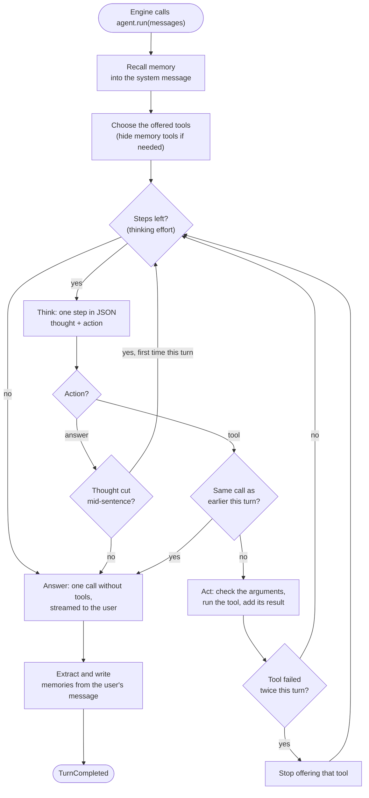
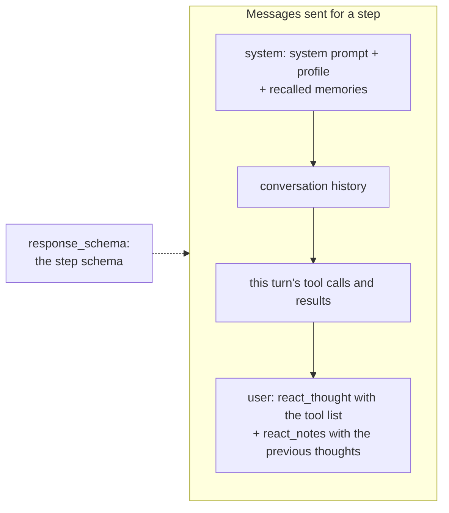
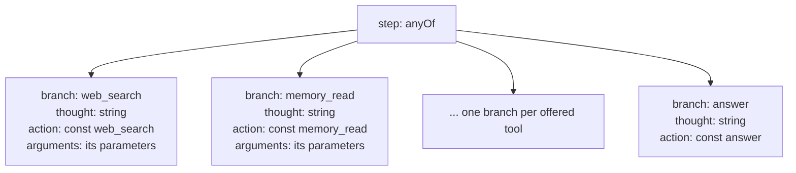
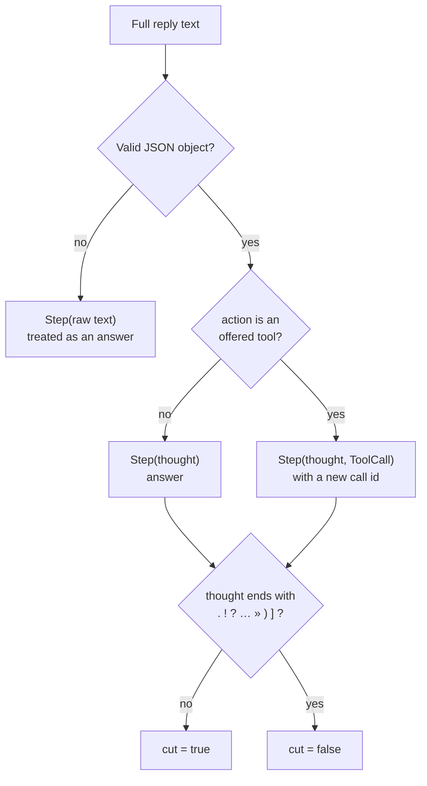
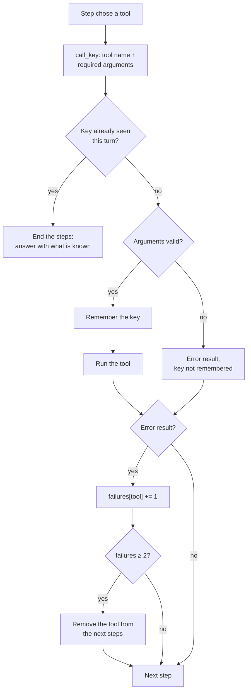
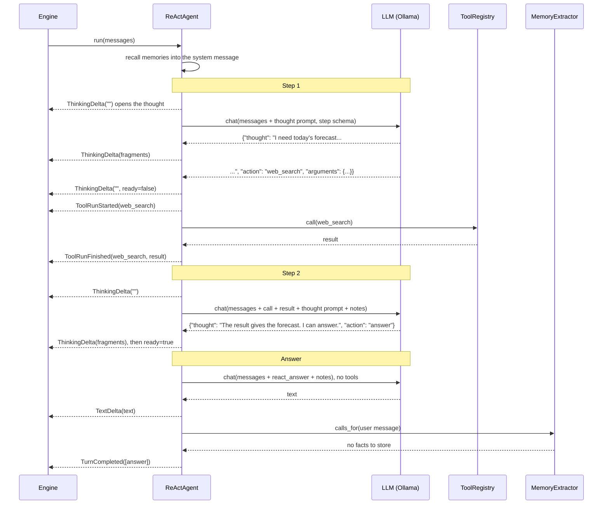
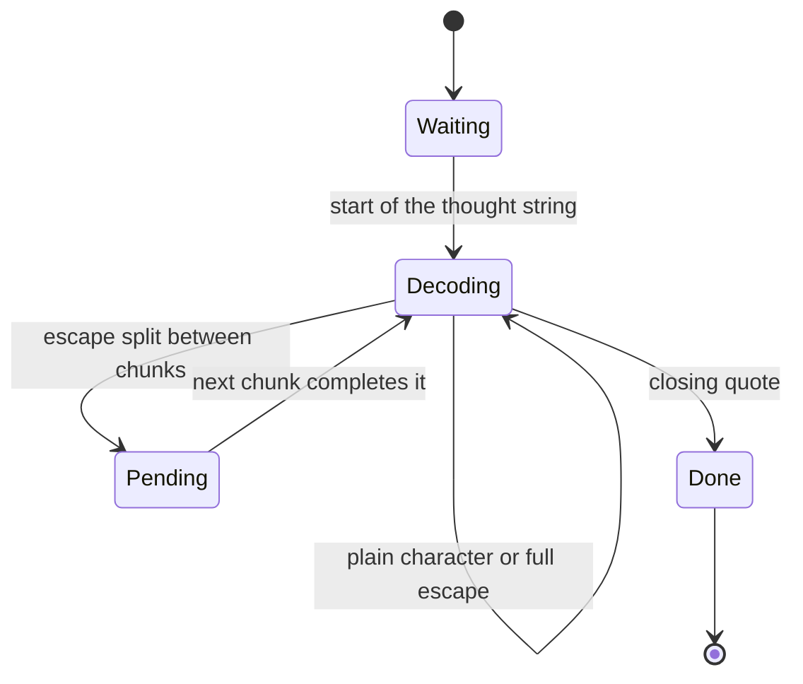

# The ReAct Process

`ReActAgent` (`core/agent/re_act.py`) answers a message in two phases: a few
private **steps**, where it reasons and calls tools, then one **answer**, the
only text the user gets as the reply. This page follows a turn from the moment
the Engine hands over the conversation to the moment the answer is stored.

For the agent's prompts and memory, see [Agent](agent.md); for how its events
reach a front-end, see [Engine and Event Bus](engine.md).

## Overview



The loop body is `_loop`; each box maps to a method:

| Phase | Method | Model call |
| --- | --- | --- |
| Recall memory | `_recall_memory` | none (repository read) |
| Think | `_think` | one call, constrained by the step schema |
| Act | `_act` | none (tool registry) |
| Answer | `_answer` | one call, no tools, no schema (plan schema in plan mode) |
| Remember | `_remember` | one call by the `MemoryExtractor` |

## The budget: thinking effort

The number of steps is capped by `ThinkingEffort.level`
(`core/models/agent.py`). The user changes it with `/effort` or `Ctrl+R`; its
starting value comes from `config.agent.thinking_effort`.

| Effort | Steps at most |
| --- | --- |
| `NONE` | 0: the agent answers straight away |
| `LOW` | 2 |
| `MEDIUM` | 5 (default) |
| `HIGH` | 12 |
| `ULTRA` | 30 |

A step that calls a tool and a step that thinks again after a cut thought both
use one unit of the budget. Once the budget is spent, the agent answers with
what it has: a turn always ends with an answer.

## A step

A step is one model call that returns a **thought** and an **action**:

```json
{"thought": "The user asks for today's weather; I need a fresh source.", "action": "web_search", "arguments": {"query": "weather Paris today"}}
```

```json
{"thought": "The search result gives the forecast. I can answer.", "action": "answer"}
```

### What the model receives



- The **thought prompt** (`react_thought`) lists the offered tools with their
  description and arguments (`query (string, required), limit (integer)`), and
  asks for 1 to 3 sentences, then an action in JSON.
- The **notes** (`react_notes`) are the thoughts of the previous steps of the
  turn, numbered oldest first, marked as private to the user.
- The thought prompt is added to this call only: it never joins the run's
  messages, so the next step gets a fresh one with the updated tool list and
  notes.
- The model is never given native tools: the only way to call one is the
  action of a step.

### The step schema

The reply is constrained by a JSON Schema built from the offered tools
(`step_schema` in `core/agent/step.py`): one `anyOf` branch per tool, plus one
for the answer.



Every branch requires `thought` first and forbids extra properties. Under this
grammar the model can't:

- write a tool call as plain text;
- call a tool that is not offered;
- pair a tool with another tool's arguments, or with arguments of the wrong
  shape.

Because `thought` comes first, the reasoning streams before the model commits
to an action.

**Portable arguments.** Ollama turns the schema into a grammar, and not every
version supports every keyword. `portable_arguments` copies only `type`,
`properties`, `required`, `items` and `enum`. Descriptions and limits such as
`minimum` are dropped, which only makes the grammar looser. A tool whose
parameters combine schemas (`$ref`, `anyOf` of types, a list of types...)
accepts any object in the grammar.

**Flat fallback.** If the model server refuses the step schema before sending
anything, the agent retries the step with `flat_step_schema`:

```json
{"thought": "string", "action": "<enum of tool names and answer>", "arguments": {}}
```

It uses no `anyOf` or `const`, so arguments are any object. The agent keeps the
flat schema for the rest of the turn and tries the full one again on the next
turn. An error after part of the reply arrived is not a schema problem: it is
raised as an `AgentError`.

### Reading the step

`parse_step` turns the full reply into a `Step(thought, call, cut)`:



A reply that is not a step (cut by the length limit, or a server ignoring the
schema) becomes an answer whose thought is the raw text: the agent answers with
what it has rather than loop on a broken reply.

## Acting

When the step chose a tool, `_act` records the call as an assistant message,
then:

- **valid arguments**: the tool registry runs it and the result is added as a
  tool message;
- **invalid arguments**: nothing runs. `check_arguments` compares them with the
  tool's real parameters (including the limits the grammar dropped), and the
  error becomes the call's result: "Invalid arguments, nothing was run: ...".
  The next step sees it and can fix the call.

Either way the front-end receives `ToolRunStarted` then `ToolRunFinished`, and
the next step sees the call and its result in its messages.

## Guards

A small model loops easily: it repeats a search, retries a broken tool forever,
or answers before it has finished thinking. These guards live in the code, not
the prompt, so they hold whatever the model does.



- **Repeated call.** Calls are compared on their *required* arguments only: a
  small model repeats a search changing only its result count. A tool without
  required arguments is compared on all of them. A repeat ends the steps
  instead of running. A call rejected for its arguments is not remembered, so
  its corrected retry is not a repeat.
- **Failing tool.** A tool whose result is an error twice in a turn (invalid
  arguments count) is removed from the tool list, so neither the prompt nor the
  schema offers it again in that turn.
- **Cut thought.** A thought that does not end like a sentence was cut. The
  usual cause: the model writes a double quote to open a quotation, which
  closes the JSON string, and the schema then forces an action before the
  reasoning concluded. The prompt asks for « » or ' ' instead, and the code
  handles the rest:
  - a cut thought that chose **answer** is not trusted: once per turn, the
    agent thinks again, keeping the cut thought as a note;
  - a cut thought that chose a **tool** still runs, as its arguments are
    concrete.
- **Budget.** Once the thinking effort is spent, the agent answers.

## Answering

`_answer` makes one last call, without tools, from the conversation and the
turn's notes:

- **no tool was called**: the last user message gets the notes appended;
- **tools were called**: a user message with `react_answer` ("Answer the
  user's request now, using what you learned...") and the notes is added after
  the tool results.

In the default mode the answer streams to the user as `TextDelta` events. In
plan mode it follows the `plan` schema and is shown once, formatted as Markdown
(see [Structured Output](../structured-output.md)).

## Remembering

After the answer, `_remember` asks the `MemoryExtractor` for the facts the
user's message states and runs the planned `memory_create`, `memory_update` and
`memory_delete` calls. The model is never offered these write tools during the
steps: pushed to call some tool, it called them at random. Details are in
[Agent › Memory](agent.md#memory).

## A full turn

The user asks "What's the weather in Paris today?" at the default effort:



## Streaming the thought

The thought is shown live although it arrives inside a JSON string.
`ThoughtStream` (`core/agent/thought_stream.py`) waits for the opening
`{"thought": "`, then decodes the string chunk by chunk, JSON escapes included,
and stops at the closing quote. An escape split between two chunks, such as
`é`, waits for the next chunk.



The `ThinkingDelta` events of a step are:

1. an empty delta first, so the front-end opens the step and runs its clock
   while the model reads the prompt;
2. one delta per decoded fragment;
3. a last delta with `ready=True` when the step chose to answer (and is not a
   cut thought about to be retried). If nothing was streamed, for a reply that
   was not a step, this last delta carries the whole thought.

The Engine publishes them as `ThinkingGenerated` events; the TUI shows each
step as a `ThoughtStep` in a `ReasoningGroup` and marks it ready on the last
one.

## What is kept

Only the answer is persisted. The steps' tool calls and results, the thought
prompts, the notes and the recalled memories exist for the current turn only:

| Message | Sent to the model this turn | Stored in the history |
| --- | --- | --- |
| Recalled memories (system message) | yes | no, rebuilt every turn |
| Thought prompt and notes | yes, per call | no |
| Tool calls and results | yes, from the next step | no |
| Memory writes | no | no |
| Answer | — | yes |

`TurnCompleted` carries the stored messages, and the Engine appends them to the
conversation history. The next turn starts from the user messages and the
answers, without the previous turn's reasoning.
